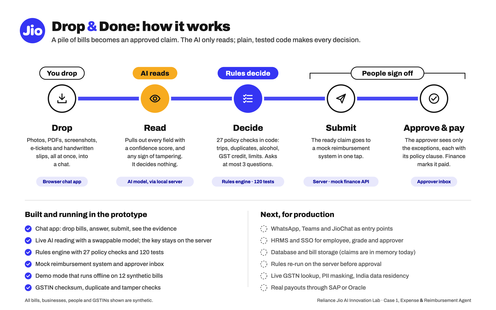
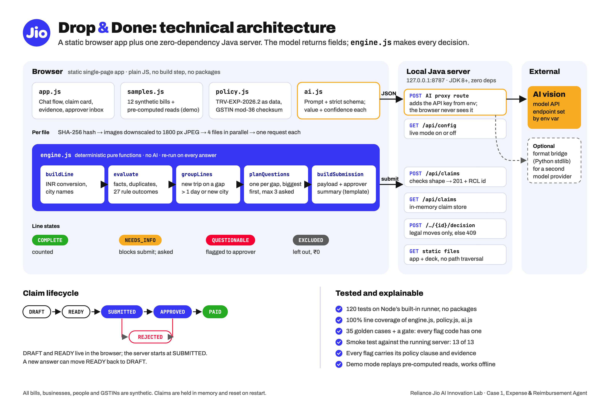

# Drop & Done

**Drop a pile of bills. Get a claim that is ready to submit.**

AI Innovation Lab Season 2, Round 2. **Track: Case 1, "Expense & Reimbursement Agent".**

Drop & Done is an AI-native reimbursement assistant. An employee drops a messy pile of bills into a chat: hotel invoices, e-tickets, cab app receipts, a faded café bill, a WhatsApp photo, a handwritten auto slip, a UPI screenshot. The assistant reads each one with AI vision, groups them into trips, checks them against company policy, asks at most three questions, and produces a submission-ready claim. The approver gets a short summary that lists only what needs attention, each item with its policy clause and evidence.

**AI reads, rules decide.** The AI only extracts fields, a confidence per field and tamper signals. Every policy decision is made by deterministic, unit-tested code, so each outcome is explainable.

- **Demo video:** [youtube.com/watch?v=DfA2MaytHfc](https://www.youtube.com/watch?v=DfA2MaytHfc)
- **Try it online:** [supriyamanjrekar.github.io/drop-and-done](https://supriyamanjrekar.github.io/drop-and-done/) (no install; bring a free AI key or use the demo pack)
- **Repository:** [github.com/SupriyaManjrekar/drop-and-done](https://github.com/SupriyaManjrekar/drop-and-done)
- **Design document:** [docs/DESIGN.md](docs/DESIGN.md) (architecture diagrams, setup and deployment, code walkthrough, assumptions, limits, testing)
- **Specification:** [docs/SPEC.md](docs/SPEC.md)
- **Pitch deck:** [02-pitch-deck/pitch-deck.html](02-pitch-deck/pitch-deck.html) (also served by the app)

[](https://www.youtube.com/watch?v=DfA2MaytHfc)

## Architecture

**How it works.** Five steps: you drop, the AI reads, rules decide, people sign off.



**Technical view.** Browser modules, the `engine.js` pipeline, the local server's routes, the claim lifecycle and the tests.



Vector versions: [overview SVG](01-architecture/architecture-diagram.svg) · [technical SVG](01-architecture/architecture-technical.svg)

## What it does

On the 12-bill sample pack, in about 35 seconds in demo mode:

| | |
|---|---|
| Reads 12 documents | photos, screenshots, an e-ticket, a hotel tax invoice, a handwritten slip |
| Groups them | Delhi trip (21-23 Sep) and Pune day trip (29 Sep) |
| Catches a duplicate | a second photo of the same cab ride (same vendor, amount and date, different file) |
| Removes alcohol | ₹900 of beer taken off the dinner bill |
| Flags lost GST credit | ₹1,392: the hotel invoice is missing the company GSTIN; one tap drafts the correction request |
| Spots a doctored bill | totals that don't reconcile, a different typeface on the total; sent to finance |
| Asks 3 questions | client meal? which total? which day? |
| Result | **₹27,847** claimable, submitted to a mock reimbursement system, approved and marked paid in the approver inbox |

## Run it in 5 minutes

Prerequisite: a **JDK 8 or newer** (`javac` on PATH, or `JAVA_HOME` set). Nothing else.

```sh
cd 03-prototype
run.bat            # Windows
sh run.sh          # macOS / Linux / Git Bash
```

Open **http://localhost:8787/**, click **Try the sample pack** and follow the [3-minute demo script](03-prototype/README.md#3-minute-demo-script).

- **Demo mode** (default, no key needed): the sample pack uses pre-computed extraction; everything else runs for real.
- **Live mode:** set `ANTHROPIC_API_KEY` in the environment before starting, and your own photos and PDFs are read live by the AI. The key stays on the local server and is never sent to the browser.
- **Live mode with a Gemini key:** also needs Python 3.8+. Set `GEMINI_API_KEY`, then run `run-gemini.bat` (Windows) or `sh run-gemini.sh`. Bills are read by gemini-3.5-flash-lite through a small local bridge (`server/gemini_bridge.py`); set `GEMINI_MODEL` to change the model. The key stays in that local process.

The server listens on `127.0.0.1` only. Do not host it with a key; see [Deployment](docs/DESIGN.md#33-deployment).

### Or run it in the browser, with no install

The same app also runs as a static site with no server: **[supriyamanjrekar.github.io/drop-and-done](https://supriyamanjrekar.github.io/drop-and-done/)**, published by GitHub Pages from `main` (the root `index.html` redirects to the app). [`.gitlab-ci.yml`](.gitlab-ci.yml) does the same on GitLab Pages. Any static file server works too, for example `python3 -m http.server` from this folder, then open `/03-prototype/app/`.

- On first open, a start screen offers two paths: **Use my key** or **Try the demo pack without a key**.
- **Your own key:** create a free Gemini API key in [Google AI Studio](https://aistudio.google.com/apikey) and paste it. Bills are then read live, straight from the browser to Google's API, on gemini-3.5-flash-lite. The key is kept in this tab only (sessionStorage), or on this device if you tick *Remember* (localStorage). **AI key > Forget key** removes it.
- **Claims** are stored in the browser (localStorage) by a copy of the mock reimbursement system with the same rules as the server, so submit, approve, send back and mark paid all work.
- Use a free key you can delete, and restrict it in Google Cloud to the Generative Language API and the site's address. Don't upload real bills with a free-tier key.

## Tests

Prerequisite: **Node.js 20 or newer** (tests only; no `npm install`). From this folder:

```sh
node --test                                  # 144 unit, integration and golden tests
node --test --experimental-test-coverage     # with line coverage
node tests/smoke.js                          # API smoke test against a running server
```

The suite covers the policy rules, GSTIN checksum, duplicates, arithmetic, grouping, the question planner, the approver summary, the AI client (with a stubbed `fetch`), the extraction schema, the full sample pack end to end, and a golden set with a gate that fails if any rule the engine can raise has no test. Line coverage of `engine.js`, `policy.js`, `ai.js` and `store.js` is 100%. Details: [docs/DESIGN.md, section 7](docs/DESIGN.md#7-testing).

## Repository layout

```
README.md               this file
docs/DESIGN.md          technical design document
docs/SPEC.md            product and technical specification (versions in docs/versions/)
01-architecture/        architecture diagrams: overview and technical (SVG + PNG)
02-pitch-deck/          pitch deck (HTML)
03-prototype/
  app/                  browser app: app.js, engine.js, policy.js, ai.js, store.js, samples.js
  server/               DropDoneServer.java (static files, AI proxy, mock finance API),
                        gemini_bridge.py (lets a Gemini key drive the same proxy)
  run.bat, run.sh       launchers; run-gemini.bat / run-gemini.sh for a Gemini key
tests/                  unit, integration, golden (tests/golden/*.json) and smoke tests
index.html, .nojekyll   GitHub Pages entry: redirects to the app
.gitlab-ci.yml          GitLab alternative: runs the tests, then publishes to GitLab Pages
```

## Data and compliance

All bills, businesses, people and GSTINs are **synthetic**. The sample GSTINs carry valid checksums so the checks run, and do not refer to real taxpayers. The policy caps and clauses are invented. No API keys are stored in the repository.
