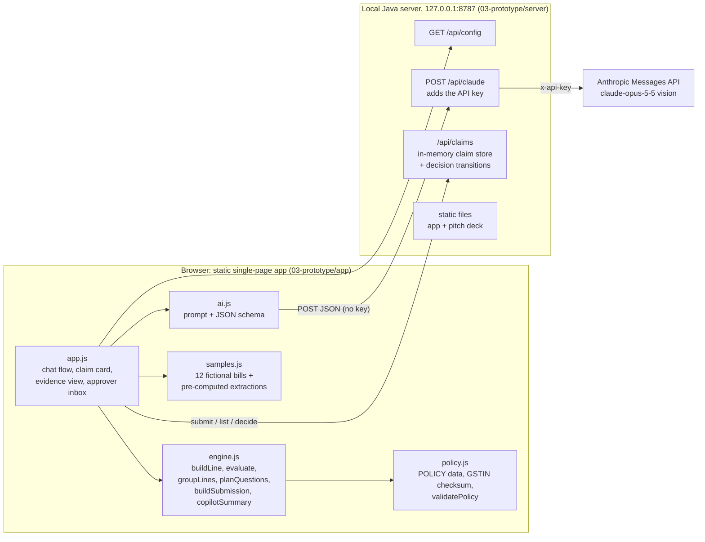
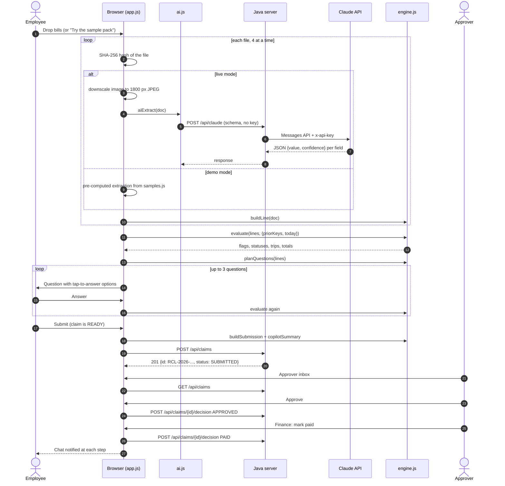
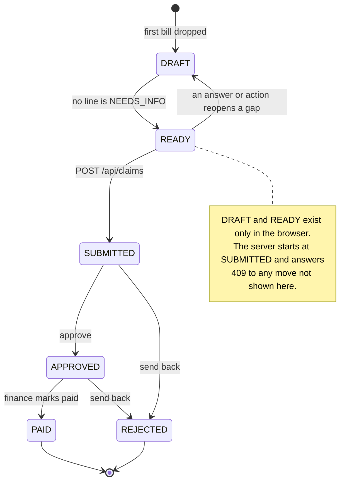
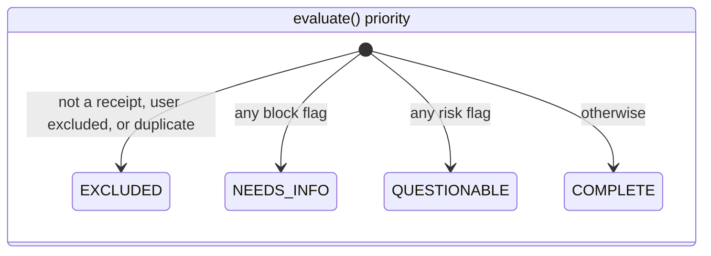

# Drop & Done: Technical Design Document

AI Innovation Lab Season 2, Round 2. **Track: Case 1, "Expense & Reimbursement Agent".**

Drop & Done is an AI-native reimbursement assistant. An employee drops a pile of messy bills (photos, PDFs, screenshots, e-tickets, handwritten slips) into a chat. The assistant reads each one with Claude vision, groups the bills into trips, checks them against company policy, asks at most three questions, and produces a submission-ready claim. The approver sees a short summary that lists only what needs attention, with the policy clause and evidence for each item.

The requirements behind this document are in [`docs/SPEC.md`](SPEC.md). This document explains how the prototype is built, how to run, test and deploy it, and which assumptions and limits apply.

---

## 1. Project overview

### 1.1 Problem
- Employees spend time keying in bills, and claims are later rejected for policy reasons.
- Finance reviews every line by hand and still misses duplicates, doctored bills and lost GST credit.
- GST input credit is lost silently when the company GSTIN is missing from a hotel or air invoice.

### 1.2 Users
| User | Need |
|---|---|
| Employee | Turn a folder of bills into a correct claim with minimal effort. |
| Approver / manager | See only the exceptions, each with its policy clause and evidence. |
| Finance | Trust the data: no duplicates, GST status known, tamper signals surfaced. |

### 1.3 How the prototype answers the Case 1 brief
The brief allows the corporate reimbursement system to be mocked; the Java server plays that role.

| Brief asks for | Where it is in Drop & Done |
|---|---|
| A familiar interface such as chat | Chat-first single-page app (`app.js`): drop files, tap answers, typed commands (`policy`, `status`, `submit`, `start over`) |
| Understands receipts and extracts data | Claude vision with a strict JSON schema, a confidence per field, line items and integrity signals (`ai.js`) |
| Groups expenses | Trips grouped by date gap and city (`engine.js groupLines`) |
| Notices missing details | Fields that are missing or below their confidence threshold become `NEEDS_INFO` lines (`engine.js evaluate`) |
| Asks only necessary questions | One tap-to-answer question per blocking line, biggest amount first, at most 3 per session (`planQuestions` + `app.js`) |
| Checks basic rules | 27 deterministic rule outcomes with policy clauses (section 5) |
| Identifies duplicates | Same file hash, same transaction from a different photo, and lines already in a submitted claim |
| Prepares a submission-ready claim | `buildSubmission` payload, posted to the mock finance API, then the approver inbox: approve, send back, mark paid |

### 1.4 What the demo shows (sample pack, demo mode)
Twelve fictional bills from a Delhi trip and a Pune day trip. On the scripted path (the dinner answered as a client meal with two attendees, the Grill Room bill answered "use items total", the auto slip given a Delhi date):

- claimable **₹27,847** in **2 trips** (Delhi trip 21-23 Sep, Pune day trip 29 Sep);
- **1 duplicate** removed (a second photo of the 21 Sep cab ride, caught by the transaction key, not the file hash);
- **₹900** of alcohol removed;
- **₹1,392** of GST credit flagged as lost on the hotel invoice;
- 1 doctored bill (Grill Room) sent to finance as questionable;
- **3 questions** asked. Pile to ready takes about 35 seconds in demo mode.

Before any answers the claimable total is ₹28,347; if the dinner is answered "just me" it is ₹26,047. These numbers are asserted by `tests/integration.test.js`.

### 1.5 Non-goals
Real HRMS/SSO integration, real payments, multi-language UI, HEIC conversion and persistent storage. Section 8 gives the production path.

---

## 2. Architecture

### 2.1 Components



A static version of this diagram is in [`01-architecture/architecture-diagram.svg`](../01-architecture/architecture-diagram.svg).

### 2.2 Design principles
1. **AI reads, rules decide.** The model only extracts fields, confidences and integrity signals. Every policy outcome comes from deterministic code in `engine.js`, so each decision is explainable (it carries a policy clause) and unit-testable. Policy decisions are never put in the prompt.
2. **Evaluation is deterministic and idempotent** for a given `(lines, answers, ctx)`. `evaluate()` writes computed fields onto the lines but recomputes them from scratch each time, so every user answer simply re-runs it. `ctx.today` can be injected; the app pins it to 30 Sep 2026 for the sample pack, and the tests do the same.
3. **Our key never reaches the browser.** With the server, it proxies the AI calls, adds the key from the `ANTHROPIC_API_KEY` environment variable, and binds to localhost only. On static hosting there is no shared key: each visitor brings their own, which stays in their browser and goes only to the AI provider (section 3.4).
4. **Two modes.** Demo mode replays pre-computed extractions for the sample pack, so the demo is reliable offline. Live mode sends each file to the AI vision model.
5. **Trust assumption (prototype).** Flags, totals and the summary are computed in the employee's browser and stored by the server as submitted. The server validates the shape of the claim but does not re-run the policy engine, and duplicate history is read back by the browser. In production `engine.js` would run on the server too (section 8).

### 2.3 End-to-end flow



### 2.4 Claim lifecycle



A claim that was sent back can be reopened in the browser and submitted again as a new claim with a new number; the rejected claim stays `REJECTED` on the server, and its bills no longer count as "already claimed".

### 2.5 Line states



| State | Meaning | Effect |
|---|---|---|
| `COMPLETE` | All checks passed, or only info / warning flags | Counted |
| `NEEDS_INFO` | A `block` flag: missing date or amount, unclear category, total mismatch, meal over cap, attendees missing | Blocks submission; becomes a question |
| `QUESTIONABLE` | A `risk` flag: tampering signals, over a cap, prior claim, invalid GSTIN, future date, unknown currency | Submittable; routed to the approver |
| `EXCLUDED` | Not a receipt, excluded by the user, or a duplicate | Claimable is 0 |

---

## 3. Setup and deployment

### 3.1 Run locally (about 5 minutes)
Prerequisite: a **JDK 8 or newer**. There are no other runtime dependencies.

```sh
git clone <repo-url>
cd <repo>/03-prototype
run.bat            # Windows
sh run.sh          # macOS / Linux / Git Bash
```

Open **http://localhost:8787/** and click **Try the sample pack**. The pitch deck is at http://localhost:8787/02-pitch-deck/pitch-deck.html.

The launchers find `javac` on `PATH` (falling back to `JAVA_HOME/bin`) and run `java` from the same JDK folder, so the compiler and runtime always match. They compile `server/DropDoneServer.java` into `server/out/` and start the server with the repository root as the served folder. On Windows they add the Windows-ROOT trust store, and on all platforms the system proxy, so live mode works behind a corporate TLS-inspecting proxy. Set `PORT` to use another port.

**Live mode:** set `ANTHROPIC_API_KEY` in the environment before starting (`set ANTHROPIC_API_KEY=...` on Windows, `export ANTHROPIC_API_KEY=...` elsewhere). The server log says `Live AI: ENABLED`. Never put the key in a file inside the repository.

### 3.2 Run the tests
Prerequisite: **Node.js 20 or newer** (tests only). From the repository root:

```sh
node --test                                  # unit, integration and golden tests
node --test --experimental-test-coverage     # with line coverage
node tests/smoke.js                          # server API smoke test (start the server first)
```

`npm test` runs the same command. Use `node --test` without a path: on Node 22 and later, `node --test tests/` is read as a file name and fails.

### 3.3 Deployment
- **Supported deployment: local only.** The server binds to `127.0.0.1`. This is deliberate: `/api/claude` has no authentication, so exposing it would let anyone spend the API key.
- **Never host it with a key.** If a hosted link is wanted, host demo mode only and label it as such.
- **Static hosting** (GitLab Pages through `.gitlab-ci.yml`, or any static server) runs the app serverless, as in section 3.4.
- **Keep the folder layout.** The launchers serve the folder above `03-prototype`; the server redirects `/` to `/03-prototype/app/` and the app links to `/02-pitch-deck/`. Moving `app/` or `server/` needs the serve root, the redirect and the deck link changed together.
- Keep any `.env` file outside the served folder; the static file handler would serve it.

### 3.4 Serverless mode (static hosting, bring your own key)
`app.js` calls `GET /api/config` at start. If the answer is not JSON (a 404 page on a static host) or the request fails, the app runs serverless:

| Concern | With the Java server | Serverless |
|---|---|---|
| AI reads | `ai.js` → `/api/claude` → AI API, server's key | `ai.js` → Gemini `generateContent` straight from the browser, visitor's key in the `x-goog-api-key` header |
| Request format | Messages format | Same Messages request, translated in `ai.js` (`toGemini`, `toGeminiSchema`, `fromGemini`), the same translation as `server/gemini_bridge.py` |
| Claims | `/api/claims` in server memory | `store.js` in localStorage: same validation, `RCL-2026-` ids, transitions and 400 / 404 / 409 errors |
| Key storage | environment variable | sessionStorage (this tab), or localStorage if the visitor ticks *Remember*; *Forget key* clears both |
| Start screen | none | how to get a free key in Google AI Studio, *Use my key* (checked with a metadata call that spends no tokens) or *Try the demo pack without a key* |

Rate limits on free keys: a 429 waits for the `retryDelay` the API sends (at most 60 s, three times); 5xx errors are retried twice; other errors show the API's message on the bill. Because the key sits in the visitor's browser, the start screen tells them to use a free key they can delete, restrict it to the Generative Language API and the site's address, and not to upload real bills on the free tier. Claims are per browser, so the cross-claim duplicate check only sees claims made in that browser.

---

## 4. Code walkthrough

| File | Role |
|---|---|
| `03-prototype/app/policy.js` | Policy as data (`POLICY`), GSTIN mod-36 checksum, `validatePolicy()` |
| `03-prototype/app/ai.js` | Extraction prompt, strict JSON schema, `aiExtract()`; serverless Gemini adapter |
| `03-prototype/app/store.js` | Serverless claim store in localStorage, same contract as the server's `/api/claims` |
| `03-prototype/app/engine.js` | Claim intelligence: line building, validation, duplicates, policy checks, grouping, question planner, submission payload, approver summary |
| `03-prototype/app/samples.js` | The 12 fictional bills, rendered to PNG in the browser, and their pre-computed extractions |
| `03-prototype/app/app.js` | Chat flow, claim card, evidence view, approver inbox, demo date pinning |
| `03-prototype/server/DropDoneServer.java` | Zero-dependency Java 8 server: static files, Claude proxy, mock finance API |
| `tests/` | Node test suite (section 7) |

### 4.1 `policy.js`
`POLICY` holds the policy version (`TRV-EXP-2026.2`), the company and employee profile, caps (hotel per night by city tier, meal per person, entertainment per head, cab per ride, no-invoice limit), allowed flight class, metro cities, the 60-day submission window, `maxQuestions = 3`, confidence thresholds, a fixed FX table and the clause texts quoted in every flag.

`isValidGstin()` checks the 15-character format (2-digit state, PAN, entity code, `Z`, check character) and the mod-36 check character from `gstinCheckChar()`. `validatePolicy()` checks the shape of a policy (positive caps, thresholds in (0, 1], `INR = 1` and positive FX rates, lowercase city and class lists, every clause `engine.js` cites) and returns a list of problems; the shipped policy is validated at load and any problem is logged to the console.

### 4.2 `ai.js`
`EXTRACTION_SCHEMA` is a strict JSON schema: every field is a `{value, confidence}` pair whose value may be `null`, plus `document_type`, `category`, `line_items[]` (with `is_alcohol`), `legibility`, `integrity_signals[]` and `notes`. Every object lists all its properties as required and sets `additionalProperties: false`.

`aiExtract(doc)` sends one file per request to `/api/claude`: images as `image` blocks, PDFs as `document` blocks, with model `claude-opus-5-5`, `output_config: {effort: 'medium', format: json_schema}` and `fallbacks: 'default'`. It throws a readable error on an HTTP error, a `refusal` stop reason or a `max_tokens` stop reason, so a truncated answer is never parsed. The system prompt tells the model to extract only what is visible, return `null` with confidence 0 for anything absent, lower its confidence for faded, handwritten or cropped values, read Indian DD/MM/YYYY dates, tell the seller GSTIN from the buyer GSTIN, mark alcohol, and report only concrete, observable integrity signals.

### 4.3 `engine.js`
**`buildLine(doc)`** turns one extraction into a line: values and confidences, currency converted to INR with the policy FX table (rupee spellings such as `Rs.` or `₹` mean INR), and city names normalised (New Delhi becomes Delhi, Bangalore becomes Bengaluru, Bombay becomes Mumbai).

**`evaluate(lines, ctx)`** runs three passes and returns `{groups, totals}`:
1. *Facts.* Category (from answers, a client-meal answer, or the extraction), effective date (used only at confidence of at least `autoFillConfidence` = 0.7, or from an answer), billed amount (confidence of at least `amountAutoFillConfidence` = 0.6, or an answer), and the transaction key `vendor|amount|date`.
2. *Duplicates.* The same file hash, or the same transaction key from a different file, marks the later line a duplicate unless the user answered "not a duplicate".
3. *Validation and policy.* Exclusions first (not a receipt, user excluded, duplicate), then required fields, unknown currency, arithmetic reconciliation (items + tax vs printed total, tolerance max(₹2, 1%)), the date window, GSTIN checks and GST credit, integrity signals, category rules (hotel, meals and entertainment, cabs, flights, payment proof without an invoice), and finally lines already in a previously submitted claim (`ctx.priorKeys`).

Each check appends a flag `{level, code, text, clause}`. The line status follows from the most severe flag: excluded, then `block`, then `risk`, otherwise complete.

**`groupLines`** sorts dated lines by date (Airfare first on the same day) and starts a new trip when the gap to the previous bill is more than 1 day, or when the city changes (only if both lines have a city). A hotel checkout date widens the displayed range afterwards. Undated lines go to a "Needs a date" group.

**`planQuestions`** returns one question for each `NEEDS_INFO` line, ordered by printed total (largest first), with tap-to-answer options for the blocking code (pick a date, type an amount, items vs printed total, client meal or solo, attendee names, category). It does not cap the list; `app.js` counts questions and stops at `POLICY.maxQuestions`, and the per-line **Fix** button lets the employee answer the rest.

**`buildSubmission`** produces the payload for the finance API (policy version, employee, totals, metrics, trips with lines and non-"good" flags, transaction keys). **`copilotSummary`** is a deterministic text template, not an LLM call: total and per-trip amounts, only the questionable lines with their reasons, what the assistant already took off, what it left out, GST credit lost, and a risk level (Low for 0, Medium for 1, High for 2 or more questionable lines).

### 4.4 `DropDoneServer.java`
| Endpoint | Method | Behaviour |
|---|---|---|
| `/api/config` | GET | `{"aiEnabled": true\|false}` |
| `/api/claude` | POST | Forwards the body to the Anthropic Messages API with the key and the `server-side-fallback-2026-07-01` beta header; 503 if no key, 502 if unreachable |
| `/api/claims` | POST | Parses the body with a small built-in JSON parser and checks it has `employee`, a numeric `totals.claimable` and `trips[].lines[]`; 400 with a reason otherwise; 201 with `{id, status: "SUBMITTED", submittedAt, claim}` |
| `/api/claims` | GET | All claims, oldest first |
| `/api/claims/{id}/decision` | POST | Body `{"decision": "APPROVED" \| "REJECTED" \| "PAID"}`. Allowed moves: `SUBMITTED` to `APPROVED` or `REJECTED`; `APPROVED` to `PAID` or `REJECTED`. Anything else is 409; an unknown id is 404; a bad body is 400 |
| `/` and other paths | GET | Redirect to the app; static files under the served folder (path traversal refused) |

Claims live in memory and are lost on restart.

---

## 5. Policy rules (policy `TRV-EXP-2026.2`)

The caps, clause numbers and company in `policy.js` are invented for the prototype.

| Code | Rule | Outcome | Clause |
|---|---|---|---|
| `duplicate` | Same file hash, or same vendor, amount and date from a different photo | Excluded (risk); "not a duplicate" overrides | §9.1 |
| `prior_claim` | Same transaction key as a line in a submitted, not rejected, claim | Questionable; not cleared by "not a duplicate"; skipped for excluded and undated lines | §9.1 |
| `hotel_cap` / `hotel_ok` | Room rate excl. GST per night above ₹7,000 (metro) / ₹5,000 (other), or within | Questionable / good | §4.2 |
| `meal_over_cap` | Meal above ₹1,500 per head after alcohol, not yet answered | Blocks: "client meal?" | §5.1 |
| `meal_capped` | After the answer, capped at heads × cap | Claimable reduced | §5.1 / §5.3 |
| `attendees_missing` | Client entertainment without attendee names (heads = 1 + attendees, ₹2,000 per head) | Blocks | §5.3 |
| `ent_ok` | Client entertainment with attendees | Good | §5.3 |
| `alcohol` | Alcoholic line items | Removed from claimable | §5.4 |
| `cab_cap` | Ride above ₹1,500 | Warning | §6.1 |
| `noinv_ok` / `noinv_over` | UPI screenshot or handwritten slip up to ₹500 / above | Info / questionable | §7.2 |
| `stale` | Older than 60 days | Warning | §2.3 |
| `flight_class` | Not economy | Questionable | §3.1 |
| `gst_lost` / `itc_ok` | Hotel or air invoice with tax, company GSTIN absent / present | Warning / good | §8.1 |
| `gstin_invalid` | Vendor GSTIN fails format or checksum | Questionable | |
| `arith_mismatch` / `arith_fixed` | Items + tax differ from the printed total: blocks; "printed" keeps it as a risk; "items" uses items + tax | Blocks, then questionable / info | |
| `integrity` | The vision model reported tamper signals | Questionable | |
| `future_date` | Dated after today | Questionable | |
| `currency_unknown` | Currency not in the policy FX table; amount taken at face value | Questionable | |
| `not_receipt` / `user_excluded` | Not a bill, or excluded by the employee | Excluded | |
| `amount_unreadable` / `date_unreadable` / `category_unclear` | Missing or below its confidence threshold | Blocks; becomes a question | |

---

## 6. Assumptions and decisions

- **Synthetic data only.** All bills, businesses, people and GSTINs are fictional. The sample GSTINs are generated with valid checksums so the checks run, and could by chance match a real taxpayer.
- **Confidence thresholds.** The date is used without asking at confidence 0.7 or more; the amount at 0.6 or more (`POLICY.amountAutoFillConfidence`). The lower amount threshold is kept on purpose: a wrong amount is still caught by arithmetic reconciliation on itemised bills and is visible to the employee and approver on every line, while a wrong date silently changes the duplicate key, the 60-day check and trip grouping. Vendor, city, GSTINs, travel class and category are used at any confidence.
- **Question cap.** `planQuestions` returns every blocking line; the cap of 3 is a session counter in `app.js`. On the scripted path exactly 3 numbered questions are asked; the attendee names are a follow-up to the first.
- **Duplicates are exact.** Vendor, rounded amount and date must match. A ±1 day fuzzy match was rejected because it would exclude legitimate repeats such as a daily cab fare.
- **Demo date.** While a claim holds only sample bills, the app treats 30 Sep 2026 as today, so the sample results never drift; bills read live use the real date.
- **Unknown currencies** are flagged for finance rather than treated as rupees; the prototype uses a fixed FX table.
- **Demo-mode integrity signals** for the doctored Grill Room bill are canned in `samples.js`. In live mode they come from the model.
- **Unverified API feature.** `fallbacks: "default"` and the `server-side-fallback-2026-07-01` beta header have not been verified against the live API. If the API rejects them, live calls fail and sample files fall back to pre-computed results (the evidence view labels the source).

---

## 7. Testing

The suite uses Node's built-in test runner, with no packages. `policy.js`, `engine.js`, `ai.js` and `samples.js` stay plain browser scripts; each ends with a guarded `module.exports` that only runs under Node, and `tests/setup.js` puts `POLICY`, `isValidGstin` and `withGstinCheck` on `globalThis` before requiring them. Every test injects `today` = 30 Sep 2026 at local midnight.

| File | Tests | What it covers |
|---|---|---|
| `tests/policy.test.js` | 14 | GSTIN checksum (valid, every wrong check character, changed PAN, length, case and spaces, 14th character, empty), round-trip, `validatePolicy`, clause references |
| `tests/engine.test.js` | 50 | Thresholds (0.69 / 0.70 date, 0.59 / 0.60 amount), duplicates, prior claims, arithmetic and answers, 60 vs 61 days, hotel nights and tiers, meals and entertainment, GST credit, GSTIN, ₹500 vs ₹501, flight class, cab cap, currencies, status priority, idempotence, grouping, question order and options, HTML escaping, totals, submission, copilot risk levels |
| `tests/ai.test.js` | 12 | `aiExtract` with a stubbed `fetch` (request shape, image vs PDF, refusal, `max_tokens`, HTTP errors, invalid JSON); schema strictness; the 12 sample extractions validate against the schema |
| `tests/integration.test.js` | 7 | The sample pack end to end: ₹28,347 / ₹27,847 / ₹26,047, 1 duplicate, ₹900 alcohol, ₹1,392 GST lost, 2 trips, the 4th question after "printed", the copilot summary, 10 of 12 `prior_claim` on a re-run |
| `tests/static.test.js` | 24 | Serverless mode: Gemini schema and request translation, key in a header and never in the URL, 5xx retries, 429 waits capped at a minute, key check; the localStorage claim store (ids, transitions, 400 / 404 / 409, validation, reload, corrupt storage) |
| `tests/golden.test.js` + `tests/golden/*.json` | 37 | 35 golden cases (synthetic bill, answers, expected status, claimable and flag codes) and a **risk-coverage gate** that fails if any flag code `engine.js` can emit has no golden case |
| `tests/smoke.js` | 13 checks | Against a running server: config, redirect, static files, path traversal, claim validation, submit and list, every allowed and refused decision, proxy without a key |

Last run: **144 tests passing**, line coverage 100% of `engine.js`, `policy.js`, `ai.js` and `store.js`; smoke test 13 of 13. The browser UI (`app.js`) is tested by hand with the demo script in `03-prototype/README.md`, and the serverless build end to end in a browser with a real key (12 bills read live, 3 questions, submit, approve, paid, reload, forget key, and the no-key demo path).

---

## 8. Limits and production path

| Prototype limit | Production path |
|---|---|
| Claims in memory, lost on restart | Postgres plus blob storage for the bills |
| One demo employee and policy | HRMS and SSO for identity; grade-based policy from a versioned policy repository |
| Engine runs in the browser; the server trusts the submitted flags and totals | Re-run `engine.js` on the server and keep claim history in the database |
| Bills sent to the LLM as they are | PII masking and data residency controls |
| No HEIC (iPhone) photos | Convert on the server |
| Duplicates by file hash and transaction key only | Add perceptual hashing for re-photographed bills |
| Fixed FX table | Rate on the transaction date |
| No audit trail of approver decisions | Tamper-evident decision log |
| Local only, no authentication | Authenticated API behind SSO; the model call stays server-side |

### Ideas taken from open-source research
Inspired by, not dependencies; found through search results and not licence-checked. "AI drafts, rules decide, human approves" (expense-auditor projects); citing the policy clause per decision; policy as declarative data validated at load (policy-engine projects); the offline GSTIN mod-36 checksum; golden cases with a coverage gate (an LLM extraction evaluation harness); arithmetic reconciliation with a tolerance for Indian GST invoices. No open-source expense tool found combines an approver dashboard with a written summary, or looks for signs of AI-generated receipts.

---

## 9. Security and compliance
- No real employee, customer or company data anywhere in the repository.
- `ANTHROPIC_API_KEY` is read from the environment only and never sent to the browser. `.env`, build output and local agent settings are in `.gitignore`.
- The server listens on `127.0.0.1` only.
- Serverless mode hosts no key. A visitor's own key stays in their browser (sessionStorage unless they choose localStorage), is sent only to Google's API in a request header, and is never put in a URL or logged.
- The static file handler refuses paths outside the served folder.
